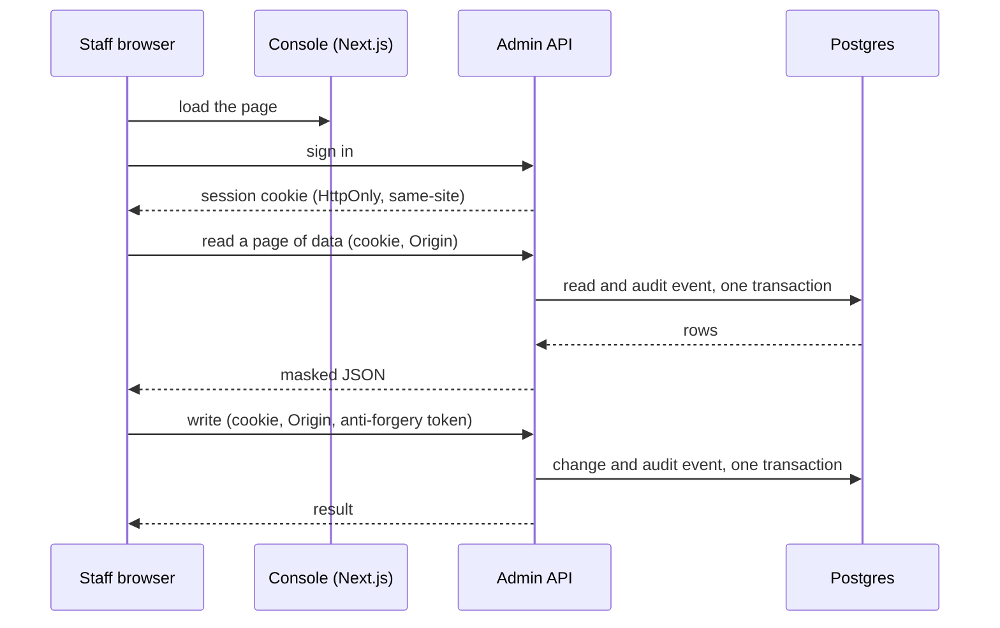

# Admin API

[Back to the README](../README.md)

## At a glance

The admin API is what the console talks to. It is the same codebase as the voice service,
started in a different role with different secrets: it holds no vendor key and never touches a
live call's audio path. Everything it returns is already masked, and every request is written
to the audit log.



## How a request is protected

| Protection | What it does |
|---|---|
| Session cookie | `HttpOnly`, `Secure`, `SameSite=Strict`, set only for the admin API's own host |
| Origin check | Only the console's exact origin is answered; other origins get no CORS headers |
| Anti-forgery token | Every write needs the session's token in a header as well as the cookie |
| Sign-in rate limit | Counted per client address |
| Audit | Every read and every write appends an event in the same transaction as the read or write |
| Masking | Names, numbers and dates are masked before the response leaves the API |

## What staff can do

| Action | Notes |
|---|---|
| Watch live calls | A server-sent event stream: phase, verified or not, last tool, timings |
| Read call history and one call's detail | Masked transcript, audit events, per-turn timings |
| Work the request list | Refills, bookings, callbacks, messages, transfers; mark one handled |
| Show callback details | The one place a full name and number are shown: an explicit action, audited, limited to 30 a minute, never cached |
| Verify the audit chain | Recomputes every HMAC and reports breaks |
| Turn the assistant off | The kill switch; the voice service picks the change up within seconds |
| Override office hours | Force open or closed, for an incident or a demo |

## How the kill switch reaches calls

The voice service reads the configuration from the database every 3 seconds into memory. A
call never waits on that read. With the assistant off, new calls are refused with a message to
phone the front desk, or 911 in an emergency; calls already connected finish normally.

## Full reference

The complete detail, for when you need the exact rule.

<details>
<summary>Open the full reference</summary>

## Reads

A JSON API for staff and graders, in `app/api/admin.py`, so the requests, messages, call
records and audit log can be read and the chain checked without opening the database. Its only
writes are the three of "Admin writes" (below), each audited. It
is off unless `ADMIN_PASSWORD` is set: then it is mounted under `/admin/api`; without it those paths
answer `404` and the app logs `admin_api_off` once at start. The console signs in to the same
API with a browser session (below, "Admin API for the console").

| Route (all `GET`) | Returns |
|---|---|
| `/admin/api/requests` | `{"requests": [...]}`: id, created_at, call_id, type, summary, patient_id |
| `/admin/api/messages` | `{"messages": [...]}`: id, created_at, call_id, kind, name (hidden), callback_number, body, patient_id |
| `/admin/api/calls` | `{"calls": [...]}`: id, call_id, started_at, ended_at, office_open, verified, patient_id, end_reason, turn_count; no transcript. `end_reason=` keeps the calls that ended one way: `completed`, `emergency`, `transferred`, `caller_hung_up`, `idle_timeout`, `max_duration` or `error`; anything else gets `422` |
| `/admin/api/calls/{call_id}` | `{"call": {...}}`: the same fields with transcript, transcript_truncated, names_masked and transcript_withheld; an unknown call or an id that is not a call id gets `404` with the same body as an unknown path |
| `/admin/api/audit` | `{"events": [...]}`: seq, ts, call_id, actor, action, resource_type, resource_id, outcome, reason; filters `call_id`, `action` |
| `/admin/api/audit/verify` | `{"ok", "checked", "breaks": [{"seq", "kind"}], "truncated"}`, as `AuditLog.verify` reports it (at most 100 breaks) |

```sh
curl -u "$ADMIN_USER:$ADMIN_PASSWORD" 'http://127.0.0.1:8000/admin/api/requests?limit=20'
```

Under Compose the admin API is its own service, `admin-api`, on `127.0.0.1:8001`; the app on
8000 serves no admin route there:

```sh
curl -u "$ADMIN_USER:$ADMIN_PASSWORD" 'http://127.0.0.1:8001/admin/api/requests?limit=20'
```

- Sign-in: HTTP Basic with `ADMIN_USER` and `ADMIN_PASSWORD`, or a browser session. The user
  name and the password are each compared as a SHA-256 digest in constant time, both always.
  Anything else (no header, a wrong part, a malformed or non-UTF-8 header, an `Authorization`
  header over 1024 characters) gets the same `401`. Credentials presented and wrong are logged
  as `admin_sign_in_failed failures=<n>`, never the name or password tried. The `401` carries the
  `WWW-Authenticate` challenge only for a request without an `Origin` header: a browser sends
  one, and must never show the Basic prompt.
- Failed sign-ins are limited per client address (`app/guard/rate_limit.py`): only
  credentials presented and wrong count (a Basic `Authorization` header, or a session sign-in's
  body); a request with none gets `401` and is not counted, so a page that makes a browser send
  bare requests locks no one out. After five failures inside a sliding minute the address gets
  `429`, before its credentials are looked at, until the oldest of them is a minute old. A
  correct sign-in is not counted. Failed sign-ins are not audited, so a stranger cannot make
  the audit chain grow.
- Paging: newest first; `limit` 1 to 100 (default 50); `before=<id or seq>` for the next page,
  the last id or seq of the page before. An unknown or repeated parameter, a value out of range
  or a filter that is not a call id or an audit action gets `422` with a fixed body. The verify
  and single-call routes take no parameters.
- One verification runs at a time: another asked for meanwhile gets `429` with `Retry-After: 5`,
  does no work and writes no event. It reads the whole chain, 1000 events a round trip, on the
  one worker that also carries the calls, so on a large chain it costs that worker and the
  database real time; run it when it is needed, not on a timer.
- Every successful read appends one audit event (actor `admin:<ADMIN_USER>`, action
  `admin_read_requests`, `admin_read_messages`, `admin_read_calls`, `admin_read_call`,
  `admin_read_audit` or `admin_verify_audit`, resource type `request`, `message`, `call` or
  `audit_event`, outcome `success`; the resource id is the call id for `admin_read_call` and
  none otherwise) in the transaction that read the rows. A call that is not found is not
  audited. If the event cannot be written the answer is `503` and
  no rows. A database that cannot be reached is `503` too, with no detail.
- Every text value from the database passes the log masking (`mask`): SSNs, dates and email
  addresses in a summary, body or transcript are hidden. Patient ids and call ids come out as stored.
  Timestamps are ISO 8601.
- Names the records know are hidden too (`<PERSON>`), in the requests' summaries, the messages'
  bodies, a call's transcript and the queue: each caller name the calls' messages hold, and the
  first and last name of each patient they name. A message's own `name` is shown hidden. A
  transcript whose names were not masked when it was stored (`names_masked` false) is not shown:
  `transcript` is null and `transcript_withheld` is `names_not_masked`.
- A callback number shows as `***-***-` and its last four digits, whatever its shape
  (`+44 20 7946 0958` shows as `***-***-0958`); with fewer than four digits it shows as
  `***-***-****`.
- Every admin response, errors and preflights included, carries `Cache-Control: no-store`,
  `X-Content-Type-Options: nosniff`, `Referrer-Policy: no-referrer` and
  `Content-Security-Policy: default-src 'none'; frame-ancestors 'none'`. The routes are not in
  the API schema, and `/docs` stays off outside dev.
- The runtime role needs no privilege for the API beyond what the calls use: it reads these
  tables and appends events.
- Limits:
  - Wrong passwords from one address block that address's sign-in for as long as they go on:
    refused requests are not counted, so each failure ages out after a minute and is replaced
    by the next, and one wrong password every 12 seconds keeps the address blocked. It delays;
    it is not a way in, and the password's strength is the real control. Behind the HTTPS proxy
    every caller has the proxy's address, and so one limit, unless the proxy's address is
    trusted for its forwarded headers (`FORWARDED_ALLOW_IPS`, below). The limit is held in
    memory, so a restart clears it, and it keeps at most 10,000 addresses, dropping the one
    that failed longest ago.
  - These reads never reveal a callback number: they show the masked form with the last four
    digits. The one route that shows a full number is the audited, rate-limited
    `POST .../callback` of "Admin writes" (below).
  - Masking hides identifiers by their shape, as in the logs, and names only where the records
    know them: a name no message or patient record holds is shown as written, and so is a
    number written another way (spelled out without a cue, for example).
  - A read event records which list was read, not which rows.

## The console's reads

The admin API has these read routes for the console, under the same rules: sign-in,
`no-store`, masked output, unknown or repeated parameters refused, one audit event per
successful read in the read's transaction and nothing without it. The reads are in
`app/audit/console.py`; days are the clinic's, and "now" is the clinic's clock (simulated in dev
and demo when set).

| Route (all `GET`) | Returns | Audit action |
|---|---|---|
| `/admin/api/calls/live` | `{"calls": [...]}`: call_id, started_at, and the latest turn's turn, phase, verified, patient_id, last_tool and timings (null before the first turn); newest first, at most 100 | `admin_read_live_calls` |
| `/admin/api/calls/{call_id}/turns` | `{"turns": [...]}`: the call's turns in order; `limit` 1 to 100, `after=<turn>` for the next page | `admin_read_call_turns` |
| `/admin/api/appointments` | `{"appointments": [...]}`: id, starts_at (clinic time), starts_at_utc, doctor, patient_id, new_patient, reason (masked), status, booked_by_call; newest first, paged as the lists above | `admin_read_appointments` |
| `/admin/api/slots?from=&days=` | `{"slots": [...], "truncated"}`: id, doctor, starts_at (clinic time), available; `days` 1 to 14 (default 7) from `from` (`YYYY-MM-DD` from 2000-01-01 to 2100-12-31, default today), at most 1,000 slots | `admin_read_slots` |
| `/admin/api/requests?type=` | the requests of one type (`refill`, `doctor_message`, `booking`, `callback`, `transfer`) | `admin_read_requests` |
| `/admin/api/guardrails/summary?days=` | `{"days", "since", "counts": [...]}`: per clinic day, action and reason, the count of `guard_block`, `emergency_detected`, `tool_refused`, `identity_locked` and `identity_refused` events; `days` 1 to 30 (default 7), today included | `admin_read_guardrails` |
| `/admin/api/metrics/summary?days=` | `{"days", "since", "calls_per_day", "ended", "verified_calls", "verification_attempts", "verification_successes", "latency", "record_us_turns", "record_us_p50", "turn_rows_dropped"}`; `latency` holds, for each kind of turn (`scripted`: the model not asked; `tool`: a tool round; `plain`: the rest) and each stage, the turns, the values, and the median and 95th percentile | `admin_read_metrics` |

- Percentiles are Postgres's `percentile_cont`, rounded to whole milliseconds. A kind of turn
  with fewer than 20 values of a stage gets the count and nulls, never a figure.
- Indexes: `audit_events (action, ts)`, `call_turns (at)`, `verification_attempts (created_at)`;
  each summary reads a window of days through them, so its cost grows with the days asked for.
- An appointment names the call that booked it when that is known: a booking writes the
  appointment and its request in one transaction, so both carry its time; exactly one call's
  booking request for the patient at that time names it. Seeded appointments have none.
- Limits:
  - Live calls are derived from recorded events, not asked of the voice process: a call appears
    once its `call_started` event is written and leaves once its `call_ended` event is. A process
    that dies mid-call leaves its calls "live" until the window has passed: 15 minutes plus
    `MAX_CALL_SECONDS` after they started.
  - Timing rows can be dropped under load (a full queue or a failed write). The count of rows
    dropped is carried on the next row written, and the metrics show the latest row's: during
    a database outage it shows only after the next successful write, and it is per process
    (the rows dropped since that voice process started; a restart counts from zero).
  - With a test clock set (`SIMULATED_NOW`) every event has the same time, so a call whose end
    was never recorded stays "live" and all calls fall on one day. Development and demo only.
  - A turn cut off by a hang-up or by an emergency heard outside the turn has no row.
    `last_tool` is the last tool that ran for the model in that turn: never a name it made up
    nor a call the gate refused (those are in the audit log as `tool_refused`).
  - At shutdown the app waits at most 5 seconds for the queued rows; what is left is dropped,
    counted and logged (`call_turns_dropped_at_shutdown`).
  - The summaries count events and rows, not their causes: a guard block's reason is its rule
    name, nothing of what was said.

## Admin console

`console/` is the admin console: a separate Next.js app (TypeScript, Tailwind, shadcn/ui,
TanStack Query, Recharts) in its own container, served at its own origin. It is a thin client of
`/admin/api/*`: it holds no data, no secret and no business rule, and shows only what the API has
already masked and audited. Pages: live calls (from the API's stream), call history and call
detail, requests, appointments and slots, the audit log with the chain check, guardrails,
metrics, config, and sign-in. How to run it, its rules and its tests are in
[console/README.md](../console/README.md).

- Its writes: mark a request handled, show a request's callback details, and switch the phone
  assistant on or off or set the office open, closed or by the schedule. Marking handled and
  each setting change ask in a dialog first; showing callback details is its own explicit
  button, recorded in the audit log and limited by the API. None is retried; the API decides and
  audits every one. Revealed callback details stay in the page's state only, and are cleared on
  Hide, on leaving, on refetch and after 60 s. While the assistant is off every page says so,
  from the session the console re-reads every 60 s.

- One setting, `ADMIN_API_ORIGIN` (the admin API's exact origin), read when a request is served:
  one image for every environment. Without a valid one the console answers 503 to everything.
- Every response carries a Content-Security-Policy with a fresh nonce (`connect-src` is the
  console itself and the admin API only), `X-Content-Type-Options: nosniff`,
  `Referrer-Policy: no-referrer` and a `Permissions-Policy` denying camera, microphone and
  geolocation. Fonts are bundled; nothing is loaded from another origin.
- Compose service `console`: loopback port `${CONSOLE_HOST_PORT:-3000}`, receives only
  `ADMIN_API_ORIGIN`, depends on nothing; nothing depends on it. Set both in the shell, not in
  `.env`:
  `ADMIN_API_ORIGIN=https://console-api.example.org docker compose --env-file .env -f deploy/docker-compose.yml up -d console`.
- It signs in through the admin API's session routes (below); the API's `CONSOLE_ORIGIN` must be
  the console's origin exactly. `npm run dev:mock` runs it against a mock of those routes.

## Admin API for the console

The console is a separate web app at its own origin; it reads only `/admin/api/*`. For it the
admin API has a browser sign-in, takes requests from exactly one other origin, streams the live
calls, and runs in a process of its own (`app/api/security.py`, `sessions.py`, `live.py`,
`service.py`).

| Route | Does | Audit action |
|---|---|---|
| `POST /admin/api/session` | body `{"user", "password"}` (JSON, at most 1 KiB): signs in and answers as `GET` does, with the session cookie | `admin_signed_in` |
| `GET /admin/api/session` | `{"user", "csrf_token", "expires_in", "calls", "office_open", "time_zone"}`: who is signed in, the session's anti-forgery token, the seconds left if it is not used, whether calls are on (`"on"`, `"off"`, or `null` when the config cannot be read), and whether the office is open for a call starting now: the agent's clock (simulated when set), or the office override set on the config page, both read from the table in one read when asked (if that read fails, the clock's answer), with the clinic's zone; `401` when not signed in | none (reads no patient data) |
| `DELETE /admin/api/session` | ends the session and clears the cookie; `204`, always: if `admin_signed_out` cannot be written the session ends all the same, and the log says `admin_sign_out_unaudited` | `admin_signed_out` |
| `GET /admin/api/queue?type=&before=&state=` | `{"requests": [...]}`: the Requests page's rows, newest received first (the higher id first at the same instant), 50 a page; each with id, created_at, call_id, type, summary (masked, names hidden), patient_id, `callbacks` (the masked numbers of the messages it was left with), `after_hours` and `handled` (`{"by", "at"}` or `null`); never the caller's name. `state` is `todo` (the default: not handled), `handled` or `all`. `before=<id>` is the last request of the page before | `admin_read_queue` |
| `GET /admin/api/calls/{call_id}/detail` | `{"call": {...}, "events": [...]}`: the call as `/admin/api/calls/{call_id}` shows it, and its audit events oldest first (the latest 100) | `admin_read_call_detail` |
| `GET /admin/api/calls/live/stream` | `text/event-stream` of the live calls, session only | `admin_read_live_calls`, once per stream |

Two ways to sign in, one check (`AdminAccess`):

- HTTP Basic, for scripts, reads only: a state-changing request with Basic
  alone is refused. The stream refuses Basic.
- A browser session: `POST /admin/api/session` checks the user and password as Basic does, in
  constant time, against the same failed-sign-in limit (failures of either kind count for the
  address), and answers every failure the same way (`401 {"detail": "Sign-in failed"}`). On
  success it opens a new session: 32 random bytes, of which the server keeps only the SHA-256;
  8 hours at most, 30 minutes idle; at most 32 sessions, the one used longest ago ending first.
  Outside dev the id goes in the cookie `__Host-admin_session`: `Secure`, `HttpOnly`,
  `SameSite=Strict`, `Path=/`, no `Domain`, no expiry (it ends with the browser). The
  `__Host-` prefix is why: a browser accepts such a cookie only from this host itself, so a
  sibling host of the site can neither plant one nor overwrite it. In dev, over plain http
  where that prefix cannot be used, it is `admin_session` with `Path=/admin/api` and no
  `Secure`. No audit event, no session: if `admin_signed_in` cannot be written the answer is
  `503`. A sign-in from a browser that holds a session ends that one.
- A read with a session keeps it alive; `GET /admin/api/session` and the stream do not.
- Sessions are held in memory: restarting `admin-api` signs everyone out.

Anti-forgery. Other apps live on sibling hosts of the same site, and a cookie's `SameSite` rule
treats them as the same site, so it is no defence here; these rules are:

- Every state-changing request under a session (`POST`, `DELETE`, and any `PUT` or `PATCH` to
  come) needs `X-CSRF-Token` equal to the session's token (compared in constant time) and an
  `Origin` equal to `CONSOLE_ORIGIN`, or to the API's own origin when that is not set. Else
  `403`.
- Signing in has no token yet: it needs that `Origin` and `Content-Type: application/json`, so a
  form posted from another page is refused (`403`) before the password is looked at.
- With `CONSOLE_ORIGIN` set, a session is honoured only for a request whose `Origin` is exactly
  it; the console's requests are all cross-origin, so they always carry it. A request with
  another `Origin` or none (a link, an image, a form of a sibling page) is answered as signed
  out on every route and the stream: it reads nothing, keeps nothing alive and cannot take the
  console's stream. Without `CONSOLE_ORIGIN` the console is the API's own origin, and a request
  with that `Origin` or none (a browser's own same-origin read) is honoured.
- `GET` changes nothing but its own audit event and the session's idle time.

CORS: `CONSOLE_ORIGIN` is one exact origin (`https://console.example.org`: scheme, lower-case
host, optional port but never the scheme's own (`:443`, `:80`: a browser leaves it out, so it
would never match); no path, no wildcard; `http` only with `APP_ENV=dev`). Requests from it get
`Access-Control-Allow-Origin` with that origin (never `*`),
`Access-Control-Allow-Credentials: true` and `Access-Control-Expose-Headers: Retry-After` (when
to try a refused sign-in again); preflights get the methods `GET, POST, DELETE`, the
headers `Content-Type, X-CSRF-Token`, and `Access-Control-Max-Age: 600`. Every answer carries
`Vary: Origin`. Any other origin gets no CORS header, and with `CONSOLE_ORIGIN` unset nobody
does. The console reads the stream with `new EventSource(url, {withCredentials: true})` and the
rest with `fetch(url, {credentials: "include"})`.

The live calls stream:

- At the opening one audited read of the live calls, sent as an event `calls` (the JSON list,
  as `/admin/api/calls/live` gives it); no event, no stream. Then every 2 seconds the session
  is looked at (without keeping it alive) and the live calls read again in a transaction of
  its own, with no audit event; `calls` is sent only when the list differs from the last one
  sent. A comment line every 15 seconds keeps proxies from closing it, and
  `X-Accel-Buffering: no` keeps nginx from holding it back.
- A read that fails sends `paused` once; the next tick tries again, and the first read that
  works sends the list again, changed or not.
- When the session ends (signed out, idle or 8 hours) the stream sends `signed_out` and
  closes. After 5 minutes it sends `renew` and closes, and the page opens a new one.
- At most 5 streams are open per process and one per session: a newer stream of the session
  closes the older, which first sends `replaced` (`data: {}`); the page that held it closes
  its `EventSource` and does not reconnect. A sixth session gets `429`.
- A client that stops reading is dropped once the send buffer fills (a write then waits 10
  seconds and gives up) or at the 5-minute renewal, whichever comes first; what is held for it
  stays bounded.

Roles: `APP_ROLE` picks what a process serves, from the same image and command
(`app/server.py`).

| `APP_ROLE` | Serves |
|---|---|
| `all` (default) | the calls, and the admin API when `ADMIN_PASSWORD` is set: for development and tests |
| `voice` | the calls only: no admin route, whatever it is given. It ignores `ADMIN_PASSWORD` (its settings hold none) and logs `other_role_settings_ignored names=ADMIN_PASSWORD` once when given it |
| `admin` | the admin API and `/health` only. No call route, and the calls' code (the voice pipeline, Pipecat, the model's client) is never imported. It ignores `IDENTITY_HASH_KEY`, `TURN_SHARED_SECRET`, `TURN_HOST`, `CALL_ACCESS_TOKEN` and the vendors' keys (its settings hold none, and it logs the names of those it was given once), and starts without them. Without `ADMIN_PASSWORD` it still starts, answers `/health`, answers `404` to everything under `/admin`, and logs `admin_off_no_password` once |

In Compose `app` runs `voice` and `admin-api` runs `admin`, each with only its own variables
(the README's Configuration). Each long-running service holds only some of the secrets, so the one-shot
`startup` service is given all of them and its first step (`python -m app.config`) checks them
together as `all` does: each strong, and every secret different from every other (the admin
password, both database passwords, the audit and identity keys, the TURN secret, the call
access token and the vendors' keys). A clash stops the deployment before `app` and `admin-api`
start, naming both settings and no value.

Behind a proxy: the sign-in limit counts by client address, and the API's own origin is read
from the request's scheme and `Host`. Compose gives `admin-api` one variable that is no
setting, `FORWARDED_ALLOW_IPS` (default `127.0.0.1`), which uvicorn reads itself: the addresses
whose `X-Forwarded-For` and `X-Forwarded-Proto` it trusts. When the API runs behind a proxy, set
it to the proxy's network, in the shell like `APP_HOST_PORT` and not in `.env`; otherwise every
caller shares the proxy's address and one limit. Set `CONSOLE_ORIGIN` there too.

- Limits:
  - Sessions and stream places are per process and in memory: one `admin-api` process, no
    sharing between replicas.

## Admin writes: handled, callback details, config and the kill switch

Three writes (`app/api/writes.py`). Each needs a browser session (never Basic), its
`X-CSRF-Token` and the `Origin` rule above; a JSON body (`Content-Type: application/json`, else
`415`) of at most 1 KiB (else `413`) with no field it does not know (else
`422 {"detail": "Invalid request"}`, which echoes nothing). Each writes its audit event in the
transaction of the change: no event, no change, and the answer is `503`.

| Route | Does | Audit action |
|---|---|---|
| `POST /admin/api/queue/{source}/{id}/handled` | body `{}`. `201 {"source", "id", "handled": {"by", "at"}}`; again, `200` with the same mark, nothing written. `{source}` is `requests`, the table the queue's rows come from; any other, or a row that is not there, `404` with no event | `admin_marked_handled`, outcome `success` or `already` |
| `POST /admin/api/queue/{source}/{id}/callback` | body `{}`. `200 {"source", "id", "callbacks": [{"name", "callback_number"}]}`: the caller's name and full number of each message the request was left with that has a number to call back, oldest first. The one route that answers with values unmasked: a `POST`, so they are never in a URL or a cache, and they are in no log line, audit row or error. A row without a number, `404` with no event. At most 30 a minute per session: then `429 {"detail": "Too many requests"}` with `Retry-After: 60`, nothing shown, no event, and the log says `admin_reveal_limited` | `admin_revealed_callback` (record: the request) |
| `GET /admin/api/config` | `{"config": {"calls": {"value", "changed_by", "changed_at"}, "office": {...}}, "applies_within_seconds": 5, "facts": {"environment", "model", "speech_to_text", "text_to_speech", "max_concurrent_calls", "max_call_seconds", "test_clock"}}`; Basic or a session. Nothing secret, no key. The facts are the admin process's own settings; in Compose both processes are given the same values | `admin_read_config` |
| `POST /admin/api/config` | body `{"key", "value", "confirm": true}`. `201 {"key", "value", "changed_by", "changed_at", "applies_within_seconds": 5}`; the value it already has, `200` with the current setting, nothing written | `admin_changed_config`, outcome `success` or `unchanged`, reason `calls_on`, `calls_off`, `office_schedule`, `office_open` or `office_closed` |

The config's keys and values are a closed set, checked in code and by the table
(`config_changes`): `calls` is `on` (default) or `off`; `office` is `schedule` (default: its
hours decide), `open` or `closed`. A key's value is its newest row. Marks (`handled_marks`) and
changes are only ever added: the runtime role may insert and read them, never update or delete.
There is no unmarking in this version.

The voice service reads the config at start-up and then every 3 seconds, in one background task
(each read given up after 1 second), and holds it in memory; call handling reads only that
memory, so a call never waits on the config and a failed read never stops one. A failed read
keeps the last good values and is logged once per outage (`runtime_config_read_failed`). A
change therefore reaches calls within 5 seconds while the database answers, in every role. The
admin process runs no such task; its `GET /admin/api/session` reads both keys when asked (in at
most half a second; `"calls": null` and the office on its hours when it cannot, logged once per
outage as `admin_config_read_failed`).

- Kill switch: with `calls` `off`, `/offer` refuses a new call before reading its body:
  `503 {"reason": "unavailable"}`, which the call page shows as "The clinic's phone assistant
  is unavailable right now. Please call the front desk. If this is an emergency, call 911."
  Calls already connected go on to their end. The refusal is audited (`call_refused`, reason
  `calls_off`, no caller data) by a bounded background writer the answer does not wait for, at
  most once a minute per reason: the refusals in between are counted and logged in one line
  (`calls_refused reason=… count=N`) with the reason's next event, or at shutdown. Until its
  first read succeeds the voice service does not know the config, and refuses calls the same
  way (reason `config_unknown`). At shutdown the refusals' events and the turn rows still
  queued get 5 seconds in all.
- Office override: `open` or `closed` decides whether the office is open for calls that start
  after the change; a running call keeps the answer it started with. `schedule` is the
  office hours by the clinic's clock.

</details>
