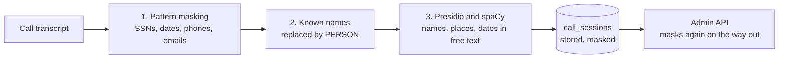

# Call record and turn timings

[Back to the README](../README.md)

## At a glance

Audio is never stored. When a call ends, one record of it is kept for staff: when it happened,
how it ended, and a transcript that has been masked three times. Each caller turn also leaves a
row of timings, used for the latency metrics. None of this work happens while the caller is
waiting.

## The three masking layers

| Layer | What it catches | How |
|---|---|---|
| 1. Patterns | SSNs (digits or spoken words), dates of birth, phone numbers, email addresses | Our own masker in `app/guard/mask.py` |
| 2. Known names | The verified patient's name and every name given to a tool, also spelled letter by letter | Replaced by a `PERSON` marker in `app/agent/call_record.py` |
| 3. Presidio with spaCy | Names, locations and dates the first two layers cannot know about | Microsoft Presidio over the spaCy model `en_core_web_sm` |

- The spaCy model is pinned and installed with the dependencies. It is never downloaded at run
  time.
- The Presidio pass runs on its own worker thread after the call, never on the loop that
  carries live calls.
- If the Presidio pass fails, the transcript from layers 1 and 2 is stored and the row is
  flagged as not fully masked. It is never stored unmasked.

## What a call record holds

| Field | Notes |
|---|---|
| Start, end, office open or closed | The call's own clock |
| Verified or not, and as which patient | A patient id, never a name |
| Why the call ended | A fixed reason code |
| Number of caller turns | |
| Masked transcript | A turn the model was never given appears as a marker, not as text |

## Turn timings

Every turn records how long each stage took: the silence wait, the final transcript, the model's
first and last token, the first audio, and the whole turn. The rows hold only ids, fixed names
and numbers. They are written by a background task from a queue, so recording a turn costs the
call nothing; if the queue is full a row is dropped and counted, never raised into the call.

## Known limit

Masking free text is best effort. The language model behind layer 3 can over-mask ordinary
words such as "today" and can miss an unusual name.

## Full reference

The complete detail, for when you need the exact rule.

Open the full reference

## Call record

After a call has ended, `record_call` (`app/agent/call_record.py`) stores one row of
`call_sessions` for it: call id, started and ended at, whether the office was open, whether the
caller was verified and the patient id code verified them as (or none), the end reason, the
number of caller turns, and the transcript. Audio is never stored.

- The transcript is the conversation as the model was given it and as the agent said it, one
  line per message (`caller: ...`, `agent: ...`): each caller turn as the input guard passed it
  on, each line said, scripted ones included. A turn the guard swallowed (the SSN step) is the
  fixed line `caller: (turn withheld)`, and a turn the guard took for an emergency is
  `caller: (emergency turn withheld)`; their text is never kept anywhere. Both count as caller
  turns. Tool calls, any text the model wrote beside a tool call (never said, never checked by
  the output guard) and tool results are not in it.
- It is masked three times before it is stored:
  1. `mask`: SSNs and SSN-shaped numbers, dates, phone numbers, email addresses, as in the logs.
  2. The names the call itself knows, replaced by `<PERSON>` as whole words in any case, and
     spelled out letter by letter with spaces, dots, commas or hyphens (`S A R A H`,
     `j-o-h-n-s-o-n`): the verified patient's first and last name from their patients row (if
     that read fails, `call_record_patient_lookup_failed` is logged and the first name the call
     state holds is used), and every name given to `verify_identity` (failed attempts too),
     `collect_new_patient` and `take_message`. Words of one letter are left alone. One
     compiled pattern, one pass over the text.
  3. Presidio with spaCy's small English model (`en_core_web_sm`), which replaces the names,
     locations and dates it finds in free text with `<PERSON>`, `<LOCATION>` and
     `<DATE_TIME>`. `names_masked` is true only when this pass ran.
- What the passes do not catch: a name the call never learned (a relative mentioned in passing)
  said in lower case, which the statistical model often misses; a date of birth said in words
  by a caller already verified; a street address said in lower case. Presidio can also take an
  ordinary word for a name or a date (it takes "today" for a date), and a patient whose name is
  an ordinary word (Will, May) has that word hidden everywhere. Medications, balances, lab
  status, appointment times and message content are kept by design: staff need them. The admin
  API masks again on the way out, but that pass hides shapes, not names.
- Where it runs: in a task of its own after the call has ended, which nothing on a caller's turn
  waits for. The patients read is one query on the event loop; the rest of the work runs on one
  worker thread of its own. Presidio is imported and the model loaded on the first record,
  never at start-up; the model is installed in the image from the lock and is never downloaded
  at run time.
- Limit: the worker thread keeps the work off the event loop but not out of Python's
  interpreter lock. While a record is being masked, the loop that carries the calls can stall
  for short spells. Masking in a separate process would remove that.
- If the Presidio pass fails, the text of the first two passes is stored and
  `call_record_presidio_failed` is logged with the error class. If the row cannot be written,
  `call_record_failed` is logged and the record is dropped. A call is stored once; a second
  record of it stores nothing and logs `call_record_duplicate`. Logs carry event names, the call
  id and counts, never transcript text or a name.
- The transcript is cut at a line boundary to at most 20,000 characters (before the masking
  passes, so they never read more, and again after, since a replacement can lengthen it), and
  `transcript_truncated` says so.
- At shutdown the app waits for the records still being made (`drain_call_records()`); a
  process killed outright loses them.
- The runtime role may insert and read `call_sessions`, nothing more. Read them through the
  [admin API](admin-api.md).
- The live call starts it in `CallAgent.end` (`app/agent/turn.py`), the one place a call ends:
  once `end_call` has ended the call, `record_call` is called with the ended state, the
  record's history and the end reason, and not awaited. A failure to start it is logged as
  `call_record_not_started`, never raised into the call. The history is kept beside the
  conversation the model is given, as its own list: every message the model is shown and every
  line said, with the markers in place of withheld turns. A line the caller cut short keeps
  only the words heard, and one never heard leaves it, as in the conversation, so the record
  holds what the caller heard.

## Turn timings

Each caller turn leaves one row of `call_turns`: the call id, the turn number, the time (the
call's clock, as the audit log's), the phase after the turn, whether the caller was verified and
the patient id, the input guard's action, the last tool that ran for the model in the turn,
the tool rounds, and the timings in milliseconds the pipeline already sends the page and logs as
`turn_measured` (silence wait, transcript, first token, last token, total) with the reply's first
audio. Only ids, registry names, booleans and numbers; every text column is held by a CHECK to
an id's shape or a registry's names. The runtime role may insert and read it, nothing more.

- Never on the call's time: the voice adapter hands the row to `TurnRecorder.put`
  (`app/agent/turn_record.py`), a plain function that puts it on an in-memory queue of 1,000
  rows and returns; one background task writes the queue in batches of up to 100 rows, each
  insert given up after 2 seconds. A full queue drops the row; a failed batch drops its rows;
  both are counted and logged (`call_turn_dropped`, `call_turns_write_failed`), never raised
  into the call. Each row stores the cost of its own hand-over as `record_us`, and the Metrics
  page shows its median.
- The first audio usually comes after the turn's result, so the row waits for it in the
  adapter: it goes when the turn's first line starts playing, or without a first audio when
  that line is over unheard, when the next turn is reported, or when the call ends; a turn
  with no line goes at once.
- At shutdown the app waits for the queue to be written (`TurnRecorder.drain()`), at most 5
  seconds; a process killed outright loses what was queued.

