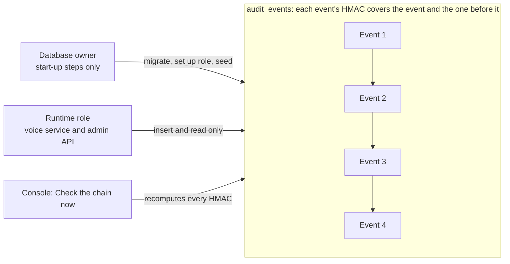

# Data, database roles, audit log and logs

[Back to the README](../README.md)

## At a glance

Everything is in one Postgres database. Two things about it matter most for a healthcare
system: the application connects as a role that **cannot change the audit log**, and the audit
log is **hash-chained**, so a change to any past event can be detected.

## The tables

| Group | Tables | Holds |
|---|---|---|
| Clinic | `patients`, `medications`, `appointments`, `available_slots` | Synthetic patients (only the last four of an SSN), their medications, appointments and open slots |
| What callers ask for | `requests`, `messages` | Refills, bookings, callbacks, doctor messages, transfers |
| Identity | `verification_attempts` | Passed and failed checks, under a keyed hash |
| Calls | `call_sessions`, `call_turns` | The masked call record and per-turn timings |
| Staff | `handled_marks`, `config_changes` | What staff marked done, and changes to the kill switch and office hours |
| Audit | `audit_events` | Every tool call and every staff read or write |

## The audit log

- **What an event holds.** Who acted, what they did, on which record, the outcome and when,
  as fixed codes and ids. Never a name, a date of birth or any value.
- **Written with the action.** An event is appended inside the same transaction as the work it
  records, so the two commit together or not at all.
- **Tamper-evident.** Events are chained with an HMAC under `AUDIT_HMAC_KEY`. Changing or
  removing a past event breaks the chain from that point on.
- **Append-only, twice over.** Database triggers refuse updates and deletes, and the runtime
  role has no privilege to do either.
- **Verifiable on demand.** "Check the chain now" on the console walks the whole chain and
  reports the first breaks.

## Two database identities

| Identity | Used by | Can do |
|---|---|---|
| Owner | The one-shot start-up job only | Migrations, role set-up, the seed |
| Runtime role | The voice service and the admin API | Read and write clinic rows; insert and read audit events; nothing else |

No long-running process ever holds the owner's credentials.

## Log masking

Every log line passes a masking formatter before it is written. Logs carry event names, ids and
counts; an SSN, a date, a phone number or an email that reaches a log line by mistake is masked
by the same patterns that mask transcripts.

## Full reference

The complete detail, for when you need the exact rule.

Open the full reference

## Tables and the seed

- A Postgres database created by Alembic migrations (`app/db/models.py`): four clinic tables
  (`patients`, `medications`, `appointments`, `available_slots`), what callers ask for
  (`requests`, `messages`), failed and passed identity checks (`verification_attempts`), call
  records and turn timings (`call_sessions`, `call_turns`), the admin's marks and config changes
  (`handled_marks`, `config_changes`) and the audit log (`audit_events`).
- A seed (`python -m app.db.seed`) that loads the synthetic patients and slots from
  `app/db/seed_data.json`, so running it again is safe:
  - A patient that is missing is inserted together with that patient's medications and
    appointment.
  - A patient that already exists is never changed, and nothing is added to it: no
    medication or appointment is inserted for an existing patient, even if a medication or
    appointment of that patient was deleted after an earlier seed.
  - Slots that are missing are added; existing slots are never changed.
  - Nothing is ever deleted. Only the last four digits of an SSN are stored.

Generated slots: on every run the seed also makes sure the next 14 business days (Monday to
Friday, strictly after today in clinic time, no holiday calendar) have slots for Dr. Patel at
9:30 AM, 11:00 AM and 3:00 PM and for Dr. Lee at 10:00 AM and 1:30 PM, America/New_York time.
These rows have `source = 'generated'`; the slots from the task data have `source = 'task'`.
A generated slot never replaces an existing slot at the same doctor and time.

## Audit log

- An audit log, `app/audit/log.py`, the only code that writes or verifies the
  `audit_events` table (tool dispatch, in [tools](tools.md), is its first caller):
  - `AuditLog(key).append(session, event, now=...)` adds an event inside the caller's
    transaction and does not commit, so the event and the action it records commit or roll
    back together. Any failure, a cancelled task included, rolls back the caller's whole
    transaction. After its INSERT, `append` reads its row back and compares every column
    with what it wrote, so an INSERT that stores nothing, stores the row somewhere else, or
    stores it changed counts as a failure.
    Appends take a transaction-scoped advisory lock and wait for it at most 5 seconds (that
    timeout stays in force for the rest of the caller's transaction), so callers append
    last, just before they commit, at the top level of their transaction: an append in a
    nested transaction, or on a session in autocommit mode, is refused. `now` must carry a time
    zone. Callers use the default isolation level, READ COMMITTED; under REPEATABLE READ or
    SERIALIZABLE an append that meets another writer fails on the primary key (it fails
    closed).
  - Every database connection the app opens is ended by the server after 30 seconds idle
    inside a transaction, so an abandoned transaction cannot hold the lock for long. Opening
    a connection gives up after 5 seconds (`connect_timeout`) when the server does not answer,
    for the app and the start-up steps alike.
  - An event holds only registry codes (action, resource type, outcome, reason) and
    identifiers of a declared shape: a call id is a version-4 UUID in hex (its version and
    variant checked), a patient id is `P` and 3 to 6 digits, an appointment, medication,
    slot, request, message or audit event id is its row number (up to 8 digits), a tool id is its registered name (2 to 40
    lower-case letters and underscores), and the actor is `agent` or `admin:` and a
    user name of letters and underscores. The database's own CHECKs are the outer bound: at
    most 64 letters, digits, `_`, `-`, `:` and `.`, no spaces.
  - Each event carries `prev_mac` and `mac`: HMAC-SHA256 under `AUDIT_HMAC_KEY` over the
    previous MAC and the event's canonical form, which is documented in the module.
    `AuditLog(key).verify(session)` walks the whole chain in batches. Its result's
    `checked` is the number of events it read, good or broken; `breaks` lists every break
    (the first 100, and `truncated` says whether there were more): an edited event, a removed or
    duplicated one, a reordering, a forged event, the wrong key, or a stored value it cannot
    read. A row's content (its MAC) and its position (its seq) are both checked, so one row
    can carry two breaks, for example a gap and a MAC mismatch next to a removed row. After a
    break it goes on from that row's stored MAC, so later tampering is still found, and one
    edit can show twice: changing only a row's stored MAC breaks that row and the link of the
    row after it. It never raises because of what is stored. A row whose seq is null (only
    possible once the owner drops the primary key) is reported as unreadable; it sorts last,
    so no row comes after it to be checked against it.
  - Limits of the chain: removing the newest events is not visible from the chain alone;
    that needs the head kept outside the database. Anyone who can INSERT can add a row at
    the next position without the key; `verify` reports it as one break and checks the
    genuine events after it. The MAC does not bind a chain to one database, so every
    database gets its own `AUDIT_HMAC_KEY`: a chain copied from another database under the
    same key is not detected.
  - Limits of the identifier shapes: they say what an identifier looks like, not what it
    means. A patient id, a row id and the digits inside a call id can coincide with other
    numbers, such as part of a date, a phone number or an SSN, and an admin user name can be
    a person's name. The control for `call_id` is where it comes from: the server generates
    it and never takes one from the caller or the model.
  - What the database enforces: triggers refuse `UPDATE`, `DELETE` and `TRUNCATE` on
    `audit_events`, and any `INSERT` out of chain position, for ordinary statements from
    every role, superusers included. Whoever owns the table, or a superuser, can still
    disable or drop the triggers or drop the table; the chain still shows any edit made that
    way. The repo's scans that keep writes to the table in `app/audit/`, the trigger switch in
    the test fixture, and raw `SAVEPOINT` or `ROLLBACK TO` text out of `app/` are lints
    against accidents, not controls: the savepoint scan reads literal strings only, so it does
    not see an SQL comment between `ROLLBACK` and `TO`, `ROLLBACK WORK TO` or
    `ROLLBACK TRANSACTION TO`, or text assembled at runtime. The control is the runtime
    database role below: the app connects as a role that neither owns the table nor is a
    superuser, and has no `UPDATE`, `DELETE` or `TRUNCATE` on it.

## Database identities

- Two database identities, and who holds what:
  - The owner (`POSTGRES_USER`, `POSTGRES_PASSWORD`, the superuser the Postgres image
    creates) is used only by the start-up steps: settings check, migrations, role set-up and
    the seed. They run in `startup`, a one-shot Compose service from the same image, which
    exits when they are done, and they read `StartupSettings` (`app/config.py`), the only
    settings class with the owner's fields.
  - The `app` service starts only once `startup` has exited with 0. Its container is given
    the application's settings only: the runtime role (`APP_DB_USER`, `APP_DB_PASSWORD`),
    where the database is (host, port, name) and the rest of `Settings`, which has no owner
    field at all. So no process in it, the server and the image's `HEALTHCHECK` included,
    ever has the owner's identity. CI checks each service's configured environment against
    its settings class, scans every process in the running app container while a
    `HEALTHCHECK` runs, and tries every value found there as the owner's password.
  - One `.env` file can hold both: each settings class takes its own keys from it and leaves
    the other's, and any key that belongs to neither still stops start-up.
  - `python -m app.db.roles` sets up the runtime role as the owner on every start of the
    stack, in one transaction under an advisory lock of its own, so set-ups that run at once
    take turns:
  - It is created if missing, with `LOGIN` and nothing else: not a superuser, cannot create
    roles or databases, no replication, no bypassing row security.
  - Its password is set on every start, so a changed `APP_DB_PASSWORD` works after the next
    start and the old one stops working for new logins. The password is never sent to the
    server: libpq (through psycopg) turns it into a SCRAM-SHA-256 verifier on the app's side,
    and only that goes into the `ALTER ROLE` statement, which is sent straight through the
    driver, so no log line, SQLAlchemy event or error message contains it, at any log level.
    A verifier in any other form is refused before it is sent.
  - It may do exactly what `app/db/grants.py` declares, and nothing else: `SELECT`, `INSERT`
    on `patients` and `appointments` (never `UPDATE`); `SELECT` on `medications`; `SELECT` on
    `available_slots` and `UPDATE` of its one column `is_available`; `SELECT`, `INSERT` on
    `audit_events`, `verification_attempts`, `requests`, `messages`, `call_sessions`,
    `call_turns`, `handled_marks` and `config_changes`; nothing on `alembic_version`; `USAGE` on
    the appointment, verification attempt, request, message, call session, call turn, handled
    mark and config change id sequences only; no `EXECUTE` on the trigger functions (a
    trigger runs its function whoever may call it) or on the functions that create large
    objects; `USAGE` on the schema; `CONNECT` on the application's database and nothing on any
    other database of the server. No table allows it `DELETE` or `TRUNCATE`. It cannot create
    a table, function, trigger, role or schema in the application's database, nor a temporary
    table or function there, and it cannot connect to any database that existed at set-up time.
  - Anything else it holds is taken away: grants the owner made it in this database and on
    databases, memberships the owner granted it (one another role granted is left in place,
    and the start refuses it), settings attached to the role, parameter privileges,
    and what it can make itself own and Postgres cannot forbid: default privileges, and large
    objects (one may remain from before their creation was closed). `PUBLIC` loses every
    privilege on the tables, sequences and functions, `CREATE` on the schema, `CREATE` and
    `TEMPORARY` on this database and everything on every other database.
  - Then set-up compares what the role can effectively do (through its own grants, `PUBLIC`'s
    and any role it belongs to) and what it is (attributes, memberships, settings, what it
    owns) with the declaration, and stops the start on any difference, listed by kind and
    name. It reads every privilege list Postgres keeps, system objects included: relations
    and their columns, functions, schemas, types, languages, foreign-data wrappers and
    servers, large objects, tablespaces, parameters, databases and default privileges. Any
    entry there naming the runtime role must be one the declaration makes; `PUBLIC`'s entries
    on everything the declaration does not manage must be exactly those Postgres installed
    (`pg_init_privs`, and for `information_schema`, which initdb does not record there,
    `USAGE` on the schema and `SELECT` on its relations but seven); no role may belong to the
    runtime role, nor it to any. A grant another role made with a grant option, which the owner
    cannot revoke, stops it that way; so does a table no declaration covers. If the role owns
    anything else, such as a table, function or schema, set-up stops and names the kind rather
    than drop it with its contents.
  - Every session the start-up steps open (migrations, role set-up, seed) waits at most 30
    seconds for any one lock and runs no statement longer than 5 minutes; the steps take about
    one to two seconds each. A step that hits either limit stops the start with a message saying
    what it waited for. No session of another role is ended.
  - The audit triggers' functions run with a pinned search path and name their table with its
    schema, so nothing created later can stand in for what they use.
  - What remains:
    - The owner's password is in the `startup` service's configuration (and in the `.env`
      file). Whoever controls the Docker host (`docker inspect`, `docker compose config`) can
      read it.
    - The verifier is in the text of the `ALTER ROLE` statement the server receives. Postgres
      would log it if `log_statement` were set to `ddl` or `all` (Compose keeps statement
      logging off). A verifier alone does not log in, but whoever holds it can guess the
      password offline, can pose as the server to a client of this role, and with one recorded
      login exchange of the role can log in as it. The password rules below still matter.
    - Anyone who can read the app container's environment gets the runtime password, which
      allows exactly the privileges above and nothing more.
    - The role can change its own password and its own session defaults (`ALTER ROLE` on
      itself, `ALTER DEFAULT PRIVILEGES`); the next start-up restores both.
    - The role must be able to take the audit chain's advisory lock, so a hostile session of
      the role can hold it and make every audit append time out (after 5 seconds) until that
      session ends.
    - The role can end its own sessions (`pg_terminate_backend` on a backend of the same role).
    - A rotated password does not end sessions opened with the old one.
    - A hostile session of the runtime role can make start-up fail, by holding the role
      set-up's advisory lock, a lock on a table it may write, or an uncommitted row the seed
      also inserts (a patient with a seed id), until that session ends.
      Restarting the database ends it.
    - Use a dedicated database server. Do not point `POSTGRES_*` at a server that hosts other
      applications: set-up takes `PUBLIC`'s privileges away on every other database on that
      server, which locks those applications out, and `DROP OWNED` takes grants on databases
      away server-wide. The Compose `db` service is such a dedicated server.
    - Do not create other databases on this server. A database created after a start-up gives
      everyone `CONNECT` and `TEMPORARY` by default, so the runtime role can connect to it and
      create objects there before the next start-up; that start-up then refuses to run until
      those objects are removed by hand.

## Log output

- Masked log output. `app/guard/logging.py` is the only place log output is configured; the
  application and each start-up step call it first. Every line goes to stderr as
  `timestamp LEVEL logger message`, and the message and any traceback pass through
  `app/guard/mask.py` first, line by line. A record's `extra` fields are not printed.
  - SSNs (`***-**-****`; after a cue such as `ssn`, `social`, `last four`, `ssn_last4`,
    `ending in`, the digits or number words that follow become `****`), dates
    (`****-**-DD`, Python's `datetime.date(...)` included), phone numbers (`***-***-` and
    the last four digits) and email addresses (`s***@***.com`) are masked. A line longer than
    10,000 characters is cut, with ` [cut]` at the end, before masking, so the last line of a
    long traceback stays. Call ids, patient ids, times, amounts, years, version numbers and
    four-digit numbers without a cue are left alone; a nine-digit or ten-digit number on its
    own is masked whatever it is.
  - Python's warnings, exceptions nobody catches (in the main thread or another) and records
    that find no handler are logged through the same formatter.
  - The level is `LOG_LEVEL`, for the root logger and uvicorn's loggers. uvicorn's access log
    is off. Pipecat (through loguru) and its WebRTC stack (`aioice`, `aiortc`) keep only
    warnings and errors, and loguru does not print the values of local variables.
  - Masking free text is best effort. The controls that matter are that the app logs event
    names, ids and counts, and that the input guard swallows SSN digits before anything
    could log them.
  - Not handled: digits said before the cue (`3344 is my ssn`), seven-digit local numbers,
    international numbers, eight-digit compact dates, quoted or internationalized email
    addresses, an identifier split across two log calls, and names. Pipecat prints a version
    banner through loguru's own sink when it is imported, before the configuration runs; a
    handler a library adds after the configuration is not covered. The repo's scans that
    keep log configuration in one module are lints against accidents.

