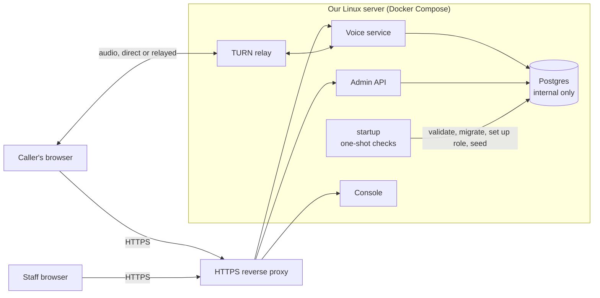

# Deployment

[Back to the README](../README.md)

## At a glance

The stack runs on our own Linux server with Docker Compose. Three web services sit behind an
HTTPS reverse proxy, each on its own origin; call audio goes directly to the server, or through
our own TURN relay when a network blocks the direct path. The database is reachable only from
inside the stack.



**Key points**

- Each service receives only its own settings; the voice service holds the vendor keys, the
  admin API holds the admin password, and neither holds the other's.
- Nothing starts until a one-shot job has validated every setting of the deployment together.
- The staff session cookie is same-site only, so the console and the admin API share one
  registrable domain.
- The TURN host is reached directly, never through the proxy.

## The origins

| Host (example) | Service | Purpose |
|---|---|---|
| `voice.example.org` | Voice service | The call page and the calls |
| `console.example.org` | Console | The staff web app |
| `console-api.example.org` | Admin API | What the console reads and writes |
| `turn.example.org` | TURN relay | Media relay, host networking, no proxy |

## What must be true for a deploy to work

### One registrable domain

The admin session cookie is `SameSite=Strict` and, outside development, `__Host-admin_session`
(`Secure`, `HttpOnly`, `Path=/`, no `Domain`). The console and the admin API must be the same
site for the browser to send it.

### Exact origins

- `CONSOLE_ORIGIN` (admin API) is the console's origin; `ADMIN_API_ORIGIN` (console) is the
  admin API's.
- Each is a scheme and a host: no path and no default port. A browser never sends `:443`, so an
  origin written with it would never match.
- `CONSOLE_ORIGIN` must be `https` outside development.

### Client addresses

Set `FORWARDED_ALLOW_IPS` for the admin API to the proxy's network, so the sign-in limit counts
each client and not the proxy. Behind a CDN the proxy sees the CDN's addresses, so the proxy
must be told to trust the CDN and pass on the client's.

### The TURN relay

- `TURN_HOST` is the relay's public name. Its DNS record points straight at the server.
- The firewall opens the relay's signalling port and its UDP relay range (both set in
  `deploy/docker-compose.yml`).
- The relay uses host networking, which needs a Linux host.

### Secrets

- Generate each with `openssl rand -hex 32`. Every secret must differ from every other; the
  start-up check refuses a deployment where two match.
- Compose gives each service only its own. If a platform gives every container every variable,
  each role ignores the other's secrets and logs their names once
  (`other_role_settings_ignored`); the values are still present in that container's
  environment.

## The start-up check

The one-shot `startup` service runs before anything else:

1. `python -m app.config` validates every setting of the deployment together.
2. The migrations run.
3. The least-privilege runtime database role is set up.
4. The seed loads.

Only then do the voice service and the admin API start. A refused start stops there, and the
log names the setting, never its value:

```text
1 validation error for DeploymentSettings
call_access_token
  Value error, call_access_token is required unless app_env is dev [type=value_error]
```

## After a deploy

1. `GET /health` on each of the three web hosts answers 200.
2. Sign in to the console.
3. Make one call from the call page.
4. On the console's Audit page, "Check the chain now" reports the chain intact.

## Scaling beyond one server

The service is a single instance today. What has to change to run several, and the plan for it,
is in the README under [Production and scale](../README.md#production-and-scale).
