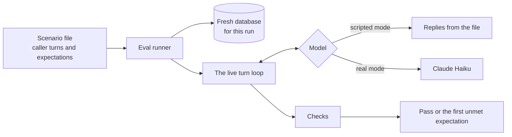

# Evals

[Back to the README](../README.md)

## At a glance

An eval is one whole phone call, run as text. It goes through exactly the same turn loop a live
call uses (the input guard, the model, the tool gate, the tools, the output guard), with only
the microphone and the speaker removed. Thirteen scenarios cover the seven calls of the
assignment and the edges around them.



## Two modes

| Mode | The model's replies | Where it runs | What it proves |
|---|---|---|---|
| Scripted | Taken from the scenario file | In CI, on every change | The guards, the gate, the tools and the database rows behave as designed |
| Real | The real Claude Haiku model | By hand, with a key | The model, given our prompt and tools, actually makes the right choices |

Both matter. The scripted run cannot see how a real model behaves: the first real run passed 7
of 13 scenarios and exposed six defects the scripted run had missed.

## What each run checks

- The scripted lines the agent said, such as the fail line or the 911 line.
- The tools that were called, with which arguments, and what they returned.
- The call's final phase and whether the caller ended up verified.
- The rows written to the database, and the audit events, in order.
- Text that must never appear: SSN digits in anything the model was sent, advice in anything
  the caller heard.
- The stored call record: masked, with stopped turns shown as markers.

## Running them

```sh
uv run python -m evals                          # scripted
uv run python -m evals --model real --runs 5    # real model; needs ANTHROPIC_API_KEY
```

## Known limit

A scenario expects one exact path. A real model that reaches the same correct end by asking one
extra confirming question fails the scenario, because the scripted caller cannot answer a
question it did not expect.

## Full reference

The complete detail, for when you need the exact rule.

<details>
<summary>Open the full reference</summary>

The demo calls, run as text through the turn loop a live call uses, in `evals/`. Each
scenario file in `evals/scenarios/` holds the call's clock (`now`), the caller's turns, the
model's side for scripted mode, and what must come of the call. The 13 scenarios and the
commands are in the README's "Testing and evals".

- Each run gets a database of its own on the server the `POSTGRES_*` environment variables
  name (as for the tests, not `.env`): copied from a template migrated once, with a runtime
  role of the evals' own (`sva_eval_<random>_app`, which must not exist yet and is dropped at
  the end), seeded for the scenario's day. The database is dropped after the run.
- A run is one call as the live pipeline makes it: a call id from the call registry,
  `start_call` on the application's tools (`call_started`), each caller turn through
  `CallAgent.handle` (the input guard, the gate, dispatch, the scripted lines), then
  `CallAgent.end` (`call_ended`): for the reason the call's last phase gives, or as a caller who
  hangs up after the last turn. The phase a scenario expects is that last phase. The call's
  clock is the scenario's `now`; the audit and claim keys are random for the run.
- Expectations, after a turn and at the end of the call: the scripted lines said, by id; the
  tools the model asked for, in order, with chosen arguments and chosen values of what each
  returned; phase and verified; the rows the call wrote (table, count, column values, compared
  with the seed); the call's audit actions in order; strings never said nor shown to the
  model (in any case, and as digits when written in digit words); the tools offered, or never
  offered; and for a turn, the input guard's flags, whether the model was shown it, and the
  output guard's rule if it withheld part of the reply. At the end of the call, `record`: the
  call's stored record exists, ends for the call's reason, holds the markers of its withheld
  turns in order (`swallowed`, `emergency`) and none of the strings it forbids (used in `s01`
  and `s06`). A turn's `expect_scripted` holds
  expectations only scripted mode checks: what comes of a reply only the scripted model gives,
  such as advice the output guard withholds. A file with an unknown key, a key given twice, or
  an empty expectation block is refused.
- Scripted mode (`tests/test_evals.py` runs every file in CI): each turn's model replies come
  from the file, and a turn must use exactly its replies. It proves the harness, the gate, the
  guards, the tools and the rows; it does not prove the model would choose those replies.
- Real mode: the model of the settings (`ANTHROPIC_API_KEY`, `LLM_MODEL`, from the
  environment or `.env`); the files' replies are ignored and the same expectations apply,
  but for each turn's `expect_scripted`. It
  refuses without a key, under pytest and in CI (`CI` set), and is never run there. It prints
  each scenario, the runs that passed and, for a failed run, the first unmet expectation by
  name, never anything said; it exits non-zero on any failure.
- Limits: the expectations are exact, so a real model that asks a tool once more, or takes
  another path to the same end, fails the scenario. Real mode has no judge of the model's
  wording beyond the strings a scenario forbids. `s09` forbids the phrasings of an approval,
  not the word: `refill_no_promise` itself says "a refill is approved" to deny it.

</details>
