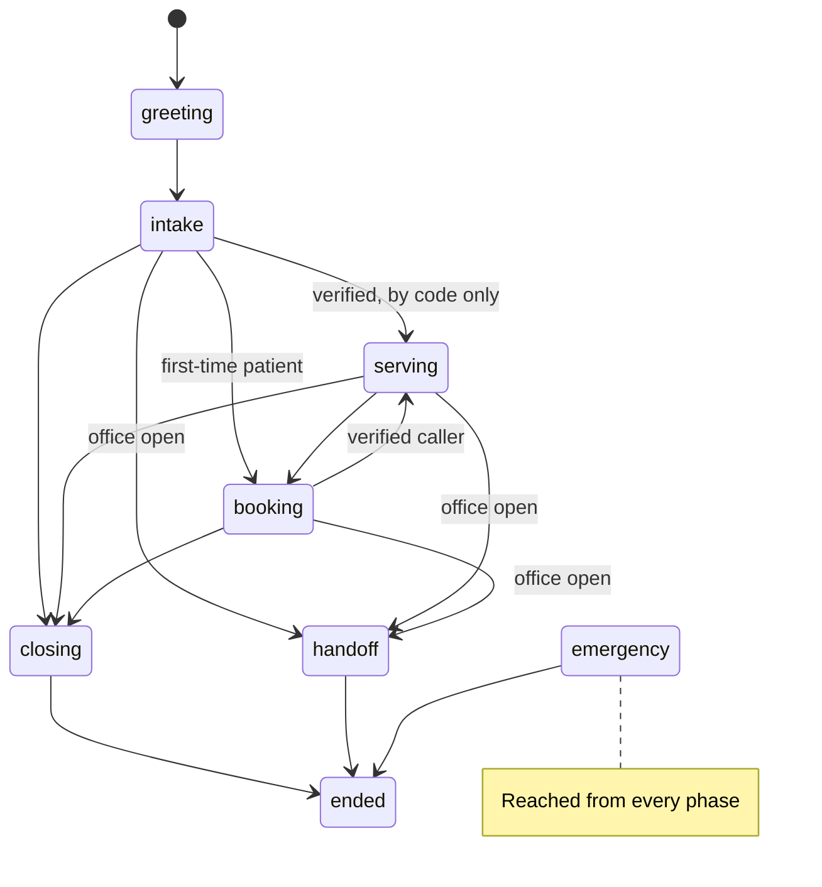

# Call state, the tool gate and the tools

[Back to the README](../README.md)

## At a glance

The model can only act through a small set of tools, and code decides which tools exist for it
at each moment. That decision, the **tool gate**, depends on three facts about the call: its
phase, whether the office is open, and whether the caller is verified. A tool the caller may not
use is not offered, and is refused again if it is called anyway.

## The tools

| Tool | Who it is for | What it does |
|---|---|---|
| `verify_identity` | A caller not yet verified, office open | Starts the identity check with a name and date of birth |
| `get_next_appointment`, `get_lab_status`, `get_balance` | A verified caller | Each reads one thing from the caller's own record |
| `request_refill` | A verified caller | Files a refill request after a read-back; with no refills left it goes to the doctor |
| `send_message_to_doctor` | A verified caller | Sends a short message after a read-back |
| `find_slots`, `book_appointment` | A verified caller | Offers up to three open slots and books one |
| `start_new_patient`, `collect_new_patient`, `book_new_patient` | A first-time caller | Collects the details a booking needs and books a slot |
| `take_message` | Any caller while the office is closed | Takes a callback message after a read-back |
| `transfer_to_staff` | Any caller while the office is open | Hands the call to staff (simulated) |
| `report_emergency` | Always | Triggers the 911 line and ends the call |
| `close_call` | Always | Ends the call with a goodbye |

## What happens when the model calls a tool

1. **Gate check, again.** Dispatch re-checks that this tool is allowed right now.
2. **Arguments are validated.** Unknown fields are refused. If details are missing, the model
   is told which of the tool's own fields to ask the caller for.
3. **The patient comes from the call, not the model.** No tool takes a patient id; the handler
   uses the verified patient in the call's state, so the model cannot name another patient.
4. **One transaction.** The tool's work and its audit event commit together or not at all.
5. **Writes need a yes.** Refills, messages, bookings and transfers first return what would be
   done, to read back; only a second call with the caller's confirmation writes.
6. **Failures are generic.** The model gets fixed text for a failure, never an exception.
   Repeated failures hand the call to staff.

## Rules the registry enforces

- A tool that touches patient data can only be offered to a verified caller with the office
  open. Registering one that breaks this is refused when the service starts.
- No tool argument may name a patient or a record owner.
- Handlers are only ever run by dispatch; a structural test reads the source to prove it.

## Full reference

The complete detail, for when you need the exact rule.

Open the full reference

## Decisions in `app/domain/`

- Pure decision functions in `app/domain/` (no database, network or settings file):
  - `office_hours.is_open`: Monday to Friday, 09:00 up to but not including 17:00, clinic
    time; `office_hours.clinic_now` gives the current or simulated time, in clinic time.
  - `matching.pick_patient`: which of the records already matched on date of birth and SSN
    last four the claimed name belongs to. Names are matched exactly, ignoring case, accents,
    spacing, hyphens, apostrophes and titles (`Dr`, `Mr`, `Mrs`, `Ms`, `Miss`): `Mary Ann
    Lee`, `Maryann Lee` and `Mary-Ann Lee` are the record Mary Ann / Lee. A suffix (`Jr`,
    `Sr`, `II`, `III`, `IV`) said or stored on one side only is ignored; on both sides it
    must be the same (`John Smith Sr` is not the record John / Smith Jr), and a name with two
    different suffixes is not a name. Any other difference, a middle name included, is a
    different name; there is no sound-alike or spelling-variant matching. Zero or two
    matching records is no match. `matching.name_key` is the name's letters with nothing
    between them and no suffix (`sarahjohnson`), so every spacing of a name has one key; it
    is coarser than matching (`Jo Anderson` and `Joan Derson` share a key).
  - `matching.match_medication`: which of the caller's own medications a spoken name means.
    It ignores case and form words (`tablet(s)`, `tab(s)`, `capsule(s)`, `cap(s)`,
    `pill(s)`, `inhaler`, `cream`, `ointment`, `solution`, `injection`, `patch`, `drops`,
    `spray`), so a form never tells two entries apart (`nicotine patch` finds a listed
    `Nicotine inhaler`). It also drops unit words (`mg`, `mcg`, `g`, `ml`, `milligram(s)`,
    `microgram(s)`, `gram(s)`, `unit(s)`, `iu`, `percent`, `%`) and a number, which may have
    one decimal point (`0.5`), when it is a strength: with a unit attached (`10mg`, `0.5mg`,
    `1%`) or right before a unit word (`10 mg`, `2000 IU`, `1 percent`). A strength never
    tells two entries apart either. A decimal comma is not understood. Every other number is
    kept and must match: `Humulin R U-500`, `Humulin 70/30` and `Vitamin B-12` keep theirs.
    A hyphen or slash next to a digit joins (`B-12` is `b12`, `70/30` is `7030`). After
    strengths are dropped, a single letter followed by a number is one word (`b 12` is
    `b12`, `u 500` is `u500`); a number followed by a unit word is a strength first, so
    `Vitamin C 500 mg` is `vitamin c` and `Humulin R U 500 units/mL` is `humulin r u`. The
    remaining words must match one for one, in order; a word of only letters, seven or more
    of them, may differ by one letter added, dropped, changed or swapped with its neighbour,
    never the first letter. A spoken name split in two (`met formin`) is joined when the
    listed name is one word and every spoken word has at least three letters and no digit.
    Zero or two matches is no match. Filler words (`my albuterol`) are not removed.

## Call state and the tool gate

The tools registered so far are the two of identity verification, the five serving tools and
the four ways a call ends, with the code-only hand-off (below); a call's turns
([call pipeline](call-pipeline.md)) offer them to the model through the gate.

- `app/agent/state.py`: a call's state (`CallState`, immutable) and its phases: `greeting`,
  `intake`, `serving`, `booking`, `emergency`, `handoff`, `closing`, `ended`. A call starts
  with `new_call` (greeting, unverified, nothing counted, a call id from the call registry);
  nothing else in `app/` constructs a state. A state changes only through transition
  functions, which refuse illegal moves (`IllegalTransitionError`): greeting to intake;
  intake to booking (a new patient); serving to booking, and booking to serving for a
  verified caller only (a new patient's booking never reaches serving); intake, serving or
  booking to closing, or to handoff while the office is open; any phase but ended to
  emergency; any phase but ended to ended (the caller can hang up at any time). Ended is
  final. `verify` is the only move from intake to serving and the only code that sets
  `verified` and the patient id, and it refuses while the office is closed. Every state is
  validated for consistency: verified goes with a patient id and a first name, an open office
  and a phase a verified caller can be in; counters are never negative. These rules hold
  against the model and the caller; code that deliberately bypasses validation
  (`model_construct`, `object.__setattr__`) can still forge a state.
- `app/agent/tool_registry.py`: a tool is declared once (name, argument model, handler,
  whether it touches patient data, its phases while the office is open and its phases while it
  is closed (none for a tool that needs the office open), whether it writes, whether the model
  may call it, whether it may verify the caller, which kind of date of birth it takes if any
  (an identity claim, or a new patient's details), the callers it is for, its audit action, any other actions its events may carry with each one's fixed outcome, the reasons
  its events may carry, and its resource type). Registration
  refuses a declaration that breaks a rule: every field given and of the right kind, the
  audit action from the audit registry and not one dispatch or the call writes itself
  (`tool_refused`, `tool_failed`, `call_started`, `call_ended`); no argument naming a patient
  or a record owner (`patient`, `patient_id`, `ssn`, `dob` and the like), by field name,
  alias or any validation alias (each choice, each step of a path), in nested models too;
  every argument model, nested ones included, forbids unknown fields; no argument takes free
  keys (a mapping), `Any` or `object`; a patient-data tool only in `serving` and `booking`,
  and never with the office closed; a
  writing tool the model can call has `confirmed: bool = False` among its arguments (a
  code-only tool is never called on the model's word); a tool that may verify is not a
  patient-data tool, is in `intake` only with the office open, is code-only, and there is at
  most one; a tool that
  takes an identity claim is not a patient-data tool, is in `intake` only with the office
  open, is callable by the model, may not verify, and there is at most one: it alone may have
  a `dob` argument; a code-only tool is registered with a grant of its own (`Grant`), a
  model-callable one without; the name is 2 to 40 lower-case letters and underscores.
- `app/agent/tools.py`: `register_tools()` is the one entry point that registers every tool
  on the application's registry and seals it; after that, registering refuses. The app calls
  it at start. The structural tests call it after importing every module under `app/`, so a
  tool registered anywhere is checked against the gate's rules; the registry is constructed
  once in `app/`.
- Who calls: `tools_for` offers the model only model-callable tools. `dispatch` without a
  grant is a model call and refuses a code-only tool; with a grant it is a code call and
  refuses any tool that grant was not registered with. The grant is an object held by the code
  that calls the tool, never anything the model sends. The gate below applies to both.
- The gate: no tool at all in `greeting`, `emergency`, `handoff`, `closing` or
  `ended`; a tool only in the phases it declares for the office's state, open or closed (the
  state's `office_open`, decided when the call starts), to the callers it declares (patient,
  new patient with or without details, claimant, locked, unidentified); a patient-data tool
  only for a verified caller with a patient id, while the office is open. Since such a tool can only be declared
  for `serving` and `booking`, it is never offered anywhere else.
- `dispatch` is the only caller of a handler. It refuses a tool name that is not a registered
  one (or not text), a tool the gate does not allow, arguments larger than 16 KiB as JSON (or
  not JSON at all) and arguments that do not validate, without running the handler.
  Otherwise, in one transaction and within 10 seconds, the handler runs (it gets the patient
  id from the state, never from the arguments), the transition it asks for is applied (a
  `Verify` only from the tool declared to verify; a line's values exactly its placeholders,
  each at most 80 characters with no control or format character; a reason only one the tool
  declares), the transaction is checked to be the one
  the handler was given, the audit event is appended, and it commits. The check reads the
  transaction's id (`pg_current_xact_id`, unique for the life of the server) before the
  handler and again after, so a handler that commits or rolls back, with SQLAlchemy or with
  SQL text, fails the call; a commit through SQLAlchemy is refused before it reaches the
  database. On any failure the connection is closed rather than reused, so the server rolls
  back whatever it holds.
- Every dispatch leaves exactly one audit event. A tool call's event names the tool when its
  resource type is `tool`, the caller's patient id (from the state, never from the handler)
  when it is `patient`, and otherwise the record the handler names. `tool_refused` (outcome
  `refused`) and `tool_failed` (outcome `failure`) events have resource type `tool` and the
  tool's name as id (none for a name that is not a registered tool) and are written in their
  own transaction. When the call is cancelled mid-tool (the caller hangs up), the work is
  rolled back and no event is written for that tool call; the call's own end event records
  the hang-up.
- The model gets fixed text for a refusal or a failure, never an exception or an argument
  value. One refusal says more: arguments that are not valid, for a tool that is offered,
  are refused with the names of the tool's own arguments that are missing or not valid
  (never a name or a value the model sent), so that the model asks the caller for them
  instead of giving the request up. Failures and refusals are counted separately: from two failures, or five refusals,
  every outcome asks for a hand-off. Tool calls of one call run one at a time.
- The application's database sessions end any statement after 5 seconds, so a connected but
  stalled server cannot hold a tool call; the start-up steps keep their own limits.
- The repo's scans that keep handler calls inside `dispatch` (any `.handler` reference, the
  text `"handler"` as `getattr` takes it, a registered handler called by name) and raw
  transaction statements out of `app/` are lints against accidents, not controls: they read
  the source as written.
- Limit: a handler that runs a raw `COMMIT` statement has committed its work before dispatch
  regains control, and dispatch cannot undo it. The call fails and no success event is
  written, but the committed rows stay; the scan keeps such SQL text out of `app/`.

## Serving tools

Five tools for a verified caller, in `app/agent/serving.py`, registered by `register_tools()`.
Each is a patient-data tool offered only in `serving`, with the office open, and acts only on
the state's patient id; none takes a patient identifier. Dispatch audits every call with
resource type `patient`, the caller's patient id and an action that says what happened:
`appointment_read`, `lab_status_read`, `balance_read`; for a refill `refill_requested` (the
request row written, or already there for this call), `refill_previewed` (needs confirmation)
or `refill_not_found` (outcome `refused`); for a message `doctor_message_sent` (written, or
already there) or `doctor_message_previewed`. Every other outcome is `success`. No medication
name, message text, balance or status reaches the audit log or the logs.

- `get_next_appointment`: the caller's earliest `scheduled` appointment at or after the moment
  of the question on the call's clock, as
  `Thursday, December 3 at 10:30 AM with Dr. Patel` in clinic time, or none.
- `request_refill(medication_name, confirmed)`: the name is matched with `match_medication`
  against the caller's own medications only. No match, or more than one: `not_found` and
  nothing else, no list. A match without `confirmed: true`: `needs_confirmation` with the
  medication and pharmacy to read back. Confirmed: a `requests` row (type `refill`, summary
  `<medication> at <pharmacy>`, built by code and cut to its first 200 characters) and
  `requested`, or `sent_to_doctor` when no refills are left, with the medication and
  pharmacy. The refill count is never returned.
- `get_lab_status`: the stored status text only; the clinic stores no results.
- `get_balance`: the balance as an exact two-decimal string (`45.00`).
- `send_message_to_doctor(summary_short, confirmed)`: 1 to 120 characters after trimming, with
  no control character (C0, NUL included, DEL or C1) or format character (zero-width ones,
  bidi overrides, embeddings and isolates, the soft hyphen) inside; anything else is refused
  without echoing it. Without `confirmed: true`:
  `needs_confirmation` with the text as it will be stored. Confirmed: a `messages` row (kind
  `doctor_message`), a `requests` row (type `doctor_message`, the same text) and the message's
  id.
- Only a JSON `true` confirms; `"true"`, `"yes"` or `1` is refused.
- A call asks for the same thing once. The same refill again in one call (the same medication,
  however it is said) or the same message again returns what the first did and writes nothing:
  the database's unique constraints decide (`requests` on call, type and summary; `messages` on
  call, kind, body, name and number, two missing values counting as the same). A later call is
  a new request.
- A failure part-way (a database error, or the audit event not written) leaves nothing
  written, gives the model the generic failure and counts toward a hand-off.
- Limits:
  - Message text is the caller's, as the model wrote it down, and is stored as given except
    that SSNs are masked as the logs mask them: a grouped or nine-digit number, and the digits
    after a cue such as `ssn`, `last four` or `ending in`. Phone numbers, dates, names and
    anything else in it are stored unmasked. The cue rule also masks an innocent number after
    such words (`ends in 2 days`). An SSN said as number words without a cue (`one two three
    four five six seven eight nine`) is not masked.
  - A message id is a row number, so it tells roughly how many messages the clinic has.

## Booking

Five tools in `app/agent/booking.py`, registered by `register_tools()`, book an appointment
for a verified patient and for a first-time caller. All need the office open.

- `start_new_patient` (intake, nobody verified, no identity claim pending, verification not
  locked): the call moves to `booking` as a new patient's call, which can never be verified
  and never reaches a patient-data tool. A locked call is offered staff, not a booking.
- `collect_new_patient` (booking, a new patient's call): `full_name` (a first and a last name,
  no digit of any script), `dob` (ISO, from 1900-01-01, not in the future; the same bounds as
  `verify_identity`), `phone` (ten digits once spaces, dots, dashes and brackets are removed;
  stored as `555-410-2233`), `email` (one `@`, a dot in the domain, at most 254 characters,
  letters, digits and `. _ % + -`), either `insurance_provider` and `member_id` or
  `self_pay: true`, and `reason_short` (1 to 120 characters, SSNs masked). No text may hold a
  Unicode control or format character (bidi overrides, zero-width characters), a line or
  paragraph separator, or a private-use or unassigned one; the doctor-message text, the
  message for the staff and the values of a scripted line follow the same rule, one check
  (`plain_text` in `app/guard/text.py`). Nothing else is accepted. The details are kept in the call's state only, hidden
  from its text form, its dumps, logs and errors; a second call replaces them and forgets the
  slots offered. The answer is the email spelled letter by letter for reading back.
- `find_slots(doctor?, preferred_days?, preferred_time_of_day?)` (serving or booking, a
  verified patient or a new patient with details): at most three open slots after the moment of
  the question, earliest first, as `{slot_id, doctor, date, time}` in clinic time. The doctor is
  one of the clinic's; days are day names; morning is before noon. The state remembers every
  slot it offered in the call.
- `book_appointment(slot_id, reason_short, confirmed)` (serving, the verified patient) and
  `book_new_patient(slot_id, confirmed)` (booking, a new patient with details): only a slot
  offered in this call. A slot not offered, taken, or begun: `slot_taken`, the same answer
  whatever the reason. Without `confirmed: true`: `needs_confirmation` with the doctor, date
  and time. Confirmed, in one transaction: the slot is taken by a single `UPDATE` that changes
  it only while it is still open and in the future, so of two callers only one gets it; then
  the new patient's record (`NP-` and a random UUID, `is_new`, no SSN, labs `None on file`,
  balance 0), the appointment and a `requests` row of type `booking`, and the audit event. A
  failure at any point leaves the slot open and nothing written. The slot row is kept, marked
  unavailable. `book_new_patient` then moves the call to `closing` and answers with the
  `booking_instructions` line; a verified patient may book more than one slot, and asking
  again for one this call booked gives the same `booked` answer and writes nothing.
- A new patient whose name key and date of birth match an existing record still gets a new
  record, flagged `possible_duplicate` for staff. The caller is told exactly the same.
- Audit actions: `new_patient_started`, `new_patient_details_collected`, `slots_offered`,
  `appointment_booked` (resource: the patient), `new_patient_booked` (resource: the
  appointment), `booking_previewed`, `booking_repeated` (a verified caller asking again for a
  slot this call booked: nothing written), and `slot_taken` (outcome `refused`).
- The runtime role may insert patients and appointments but not change or delete them, and may
  change only `is_available` on a slot.
- Limits:
  - The confirmation email is simulated, not sent. When an email is on file or was given, the
    booking's result names the appointment and dispatch writes, once the booking is committed,
    the log line `email_simulated kind=booking_confirmation appointment_id=… call_id=…` (no
    address, no name); the request's summary then reads `confirmation email simulated`. With no
    email the summary reads `confirm by phone` and no line is written.
  - The last word of the name is stored as the last name, the rest as the first name; a
    suffix (`Jr`) becomes the last name.
  - A name that is a single word cannot be collected.
  - A member id is letters, digits, spaces and dashes. In booking the input guard masks only
    SSN-shaped numbers, so a member id that reads as nine digits reaches the model masked and
    is refused; the caller needs staff for it.
  - A verified caller moved to `booking` may look for slots there but books from `serving`;
    moving between them forgets the slots offered.
  - A new patient books once per call: after booking, a repeat is refused, not answered. This
    relies on a call's turns being handled one at a time, which they are (the turn loop is
    serial per call); two bookings dispatched at once for one new-patient call are not
    supported.
  - The `slot_taken` answers do not differ in content, but their paths differ in time by a few
    milliseconds (a slot never offered is refused before any database read).
  - Slot times are rendered without the year to the caller; the staff summary carries it.

## Messages, transfer, emergency and the end of the call

The four ways a call ends or leaves the agent, in `app/agent/endings.py`, and the call's start
and end. With the office closed the model is offered exactly `take_message`,
`report_emergency` and `close_call`, in `intake`, and nothing else anywhere: each tool
declares its closed-office phases, and every other tool declares none.

- `take_message(name, callback_number, reason_short, confirmed)`: in `intake` with the office
  closed, and in `serving`. The name is 1 to 80 characters and the reason 1 to 120, each
  trimmed, with no control or format character (the same check as the doctor's message), SSNs
  masked and the bound checked after masking; the number is exactly ten digits once spaces,
  hyphens, dots and brackets are taken out, and is stored as those digits (staff call back).
  Without `confirmed: true`: `needs_confirmation` with the three to read back, nothing
  written. Confirmed: a `messages` row (kind `callback`, `after_hours` when the office was
  closed at the start of the call, the state's patient id for a verified caller and none
  otherwise) and a `requests` row (type `callback`, the reason). The same message again writes
  nothing; a corrected name or number is a message of its own, under the one request for the
  same reason. It never reads `patients`. With the office closed the call then moves to
  `closing` and the outcome names `after_hours_close`, with the name and `day` (05:00 up to
  17:00 clinic time) or `night` as its values.
- `transfer_to_staff(reason, confirmed)`: in `intake`, `serving` and `booking`, office open
  only. The reason is one of `caller_request`, `frustration`, `verification_locked` (the
  caller accepts the transfer the locked line offers) and `other`. Confirmed: a `requests` row
  (type `transfer`, the reason), the call moves to `handoff` and the outcome names `transfer`.
- `report_emergency()`: offered in every phase that has tools, open or closed. After the
  emergency no tool runs, a second report included, and the only move left is to `ended`.
- `close_call()`: in `intake`, `serving` and `booking` (`intake` only when closed). The call
  moves to `closing`, which ends any identity claim and SSN step, and the outcome names
  `goodbye`.
- `call_tool(state, name, args, deps)` in `app/agent/tools.py` is the model's tool call, as
  every turn makes it. A call naming `report_emergency` is decided first, whatever its
  arguments: where the tool is offered, it goes the emergency's one way (below), with no tool
  transaction, nothing counted and no hand-off; elsewhere it is refused like any tool. Any
  other call goes to dispatch. The outcome whose failure or refusal reaches the limit (the
  second failure, the fifth refusal) acts once: with the office open, code runs the code-only
  `hand_off_to_staff` (a `transfer` request, reason `verification_locked` for a locked call
  and `other` otherwise); with it closed the call stays where it is and the outcome names
  `fallback`, which offers the message. Later outcomes are returned as they are, and a
  call already in `closing`, `emergency` or `handoff` is left to go.
- `emergency(state, trigger, deps)`: the one way to the emergency line, for the input guard
  (`guard`) and the model's report (`model`). Every live phase moves to `emergency` and the
  line is `emergency`; the event is `emergency_detected` with the trigger as its reason.
- `start_call(call_id, deps)`: the call's first state, `office_open` from the call's clock or
  from the office override set on the console's Config page ([admin API](admin-api.md)), and
  its first line, `greeting` or `closed`; its event is `call_started`.
- `end_call(state, reason, deps)`: the one way a call ends. `completed` from `closing`,
  `emergency` from `emergency`, `transferred` from `handoff`; `caller_hung_up`,
  `idle_timeout`, `max_duration` and `error` from any live phase. Anything else is refused,
  and a reason is a member of the audit registry's `Reason`, never text. Its event,
  `call_ended` with the reason, is written once per call, however many times it is called.
- The emergency line, the start and the end never wait on the database: each returns its
  state and line before any database work, and its event is written by a task of its own that
  nobody waits for. A call's events are written in the order they happened. A write is given
  up after 2 seconds, its clean-up included (it is cancelled, then cancelled again every 0.1
  second; the driver, interrupted while it waits on the server, closes the connection), and a
  write that fails or is given up is logged as `call_audit_failed` with the event's name and
  the error's class. `drain_call_events()` waits for the writes still running, for tests and
  for shutdown.
- Every other tool call's work, state change and event commit together, as for every tool.
- Events: `message_taken`, `message_previewed`, `transfer_requested` (with its reason),
  `transfer_previewed`, `emergency_detected` (`guard` or `model`), `call_closed`,
  `call_started`, `call_ended` (with its reason), each on resource type `call` with the call
  id. No name, number or message text reaches an event or a log line.
- Schema: `messages.after_hours` (false by default), the message kind `callback`, the request
  types `callback` and `transfer`, and the messages' unique constraint on call, kind, body,
  name and number, with two missing values counting as the same.

Limits, stated plainly:

- The transfer is simulated. There is no phone system behind it: the request row and the
  event are real, and a real deployment would dial the staff where the call moves to
  `handoff`.
- A transfer the model asks for needs `confirmed: true` like any other write the model asks
  for; the code-only hand-off does not.
- The calls started and not yet ended are held in memory, per process, at most 1000 of them;
  past that the oldest is forgotten (`live_call_dropped`) and its end writes no event. A
  restart forgets them all. A `call_ended` write that fails is not tried again.
- A call event that cannot be written within its 2 seconds is lost, and the log says so; the
  call goes on. The app's shutdown waits for the writes still running
  (`drain_call_events()`, after the calls are closed); a process killed outright loses them.

